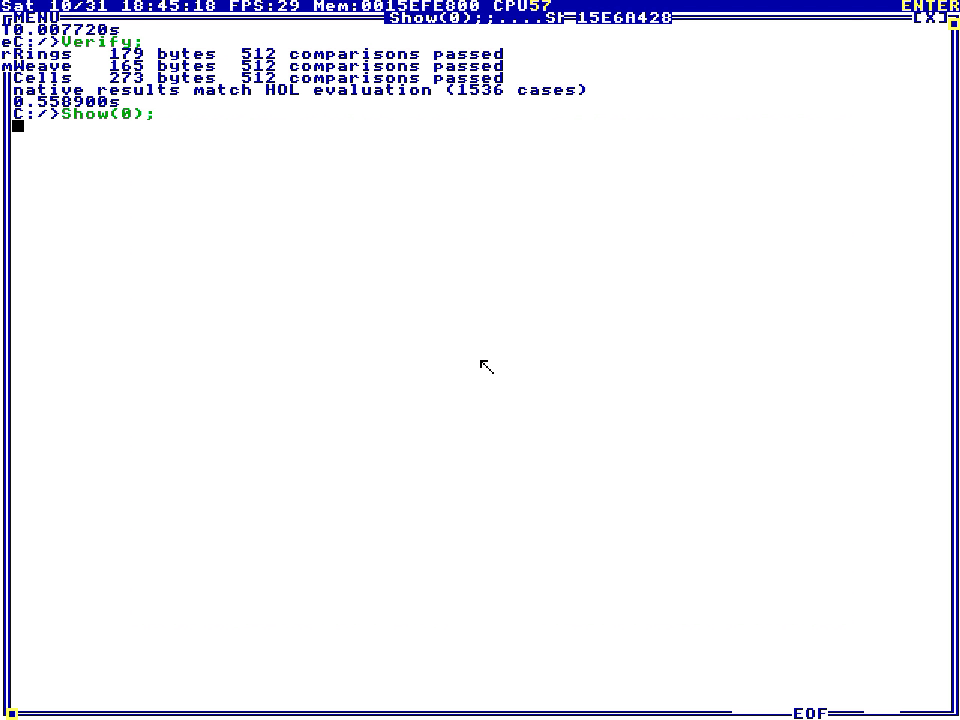
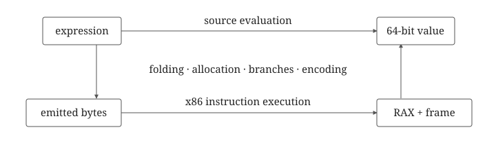

Pixel expressions compile to native x86_64 for TempleOS through an Isabelle/HOL compiler, with proofs of constant folding, register allocation, bounded branching and instruction level execution of the emitted bytes

[](media/demo.mp4)

## Build

```sh
make check
make payload
```

It uses:
- Isabelle2026 and its bundled Poly/ML toolchain 
- Python

Copy `.build/payload/*` onto `C:/` in TempleOS and run:

```c
#include "C:/Remy.HC";
Verify;
Show(0);
```

## Usage

The byte interpreter follows encoded jumps and consumes a synthetic return address through `ret`. Compare its result with `eval` using the same `x`, `y` and `t` arguments

```sh
.build/remy examples/Rings.remy /tmp/rings.bin
.build/remy simulate /tmp/rings.bin 17 23 41
.build/remy eval examples/Rings.remy 17 23 41
```

Both evaluations return `3`. `make measure` compares the original stack backend with the current compiler on the three examples and reports bytes, static stack instructions and median host pixel kernel time

## Live

The HOL packet builder serialises native code, its source snapshot and 512 reference rows for the trusted local compiler. The guest checks lengths, a checksum and every reference result before switching shaders between frames

`make guest` tests a copy of an official TempleOS RedSea ISO and leaves a bootable image that starts `Live(0)` automatically. Start that image with COM1 attached to a Unix socket, then edit the watched source file

```sh
make guest TEMPLE_ISO=/path/to/TempleOS.ISO
qemu-system-x86_64 -m 512 -smp 2 -cdrom .build/guest.iso \
  -chardev socket,id=live,path=/tmp/remy.sock,server=on,wait=off \
  -serial chardev:live &
python3 cli/watch.py examples/Rings.remy --socket /tmp/remy.sock
```

The watcher keeps one transfer in flight and coalesces edits while awaiting its acknowledgement. Syntax errors and rejected packets leave the current shader running, and Escape stops the guest renderer and receiver

## Correctness

Lexical bindings share the evaluation stack with spilled intermediates. The [allocator](src/Allocation.thy) keeps one intermediate in a register and adjusts variable offsets when it must spill, while the [branching compiler](src/Branches.thy) preserves the incoming frame and returns the expression result

The [encoder](src/core/Encoding.thy) proves inversion and byte bounds for immediate operands and stack displacements, while [native lowering](src/core/Native.thy) uses the following register convention to keep pixel inputs available across expression evaluation

| Registers | Role |
| --- | --- |
| `r8`, `r9`, `rdx` | Preserved inputs `x`, `y`, `t` |
| `rax` | Accumulator and result |
| `rcx`, `rbx` | Scratch |



## Silicon

The executable interpreter is proved sound against the inductive x86 semantics, so anything `simulate64` returns is a genuine `returns64` run with the popped return address included. On top of that 50040 random machine states and programs with edge immediates, long and short loads, misaligned jumps and raw garbage bytes go through the model, and the 16325 it accepts run on the real CPU, which has to agree on every register, the stack pointer, the stack contents and every flag the model claims to know

```sh
python3 tests/silicon.py
```
